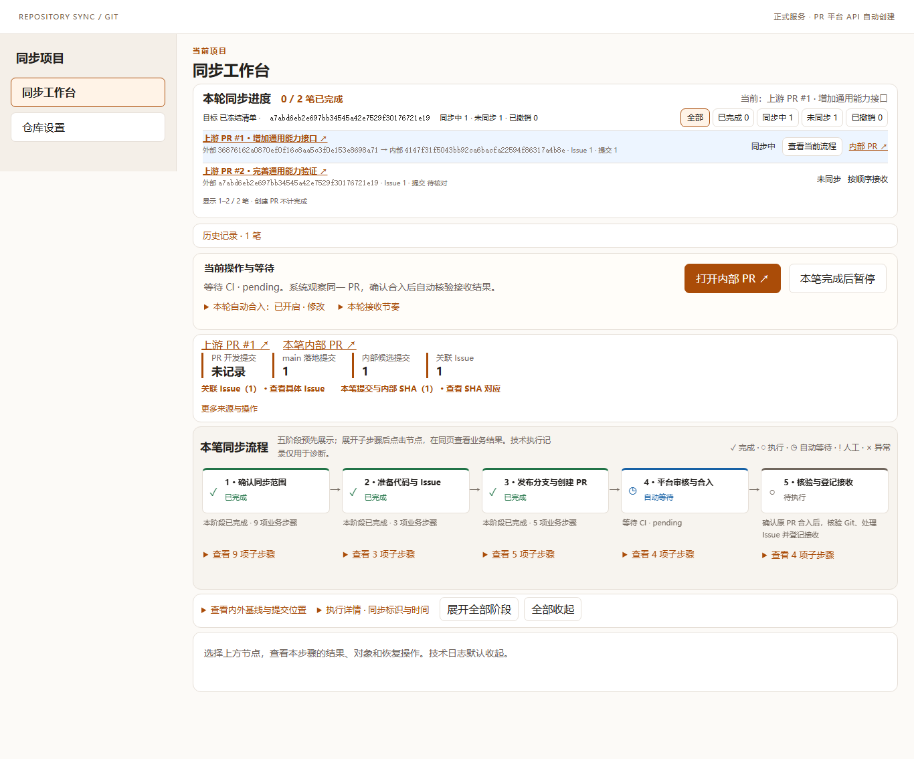

# PR #77 设计复审落实与验证记录

在现有 `feat/repo-sync-plugin` 分支和 PR #77 完整交付，不另开 PR。本记录对应用户批准的 F01—F09 取舍；是作者验证，不能替代独立审查或内网平台现场验收。

## 已实施的取舍

| 项目 | 最终行为与代码位置 |
|---|---|
| F01 文件身份 | `web/diagnostics.mjs` 独立维护所选路径、请求顺序与正文；请求串行、快速切换仅显示最后所选文件。以项目、配置修订及 U0/I0 隔离，过期响应不能覆盖另一文件。只在浏览器保存路径，不持久化正文。 |
| F02 展开布局 | `web/round.css` 将来源链接、数量、关联对象及展开操作分行，展开撤销表单不会挤窄链接；桌面保持顶部对齐，移动端五阶段改为纵排。 |
| F03 保存语义 | `web/file-rule-selection.mjs` 比较当前选择与已保存规则；树中区分已保存／新增未保存，保存成功但核验失败仍显示规则已保存。 |
| F04 完成依据 | `web/ui.mjs`、`attempts.mjs`、`step-plan.mjs` 从原接收 SHA、真实完成事件及已加载的最终成功任务投影结果。标注“未单独采集此步骤事件”；记录缺失仍显示未记录，不补造事件或时间。 |
| F05 直接恢复 | `web/error-guide.mjs`、`actionbar.mjs` 在当前操作区显示真实原因、已知对象状态及修复入口。401 不推断 PR 从未创建；原记录补存失败和执行停止未确认仍优先处理。 |
| 编辑保护 | `web/connections.mjs`、`live-workflow.mjs`、`view-state.mjs` 保留未保存选择与普通草稿；以对象、轮次和服务端保存值隔离。新保存值优先，旧草稿不覆盖；未保存的合入勾选不授予权限，Token 不进入草稿。 |
| F06 配置 | 保留三步向导；单一必选 radio 卡片，去掉重复下拉框。认证在连接环节提供，API 覆盖、身份及文件规则高级项折叠，保存按钮明确。 |
| F07 流程 | 保留五阶段全景、当前摘要、显眼的本轮清单与同页详情；子步骤默认折叠，展开全部／收起全部也覆盖子步骤，状态按笔次保存。 |
| F08 用语与时间 | “审批流”改为“本笔同步流程”；时间按浏览器本地时区显示，包含时区说明。旧记录可展示真实接收事件时间并说明来源。 |
| F09 入口与导航 | 空项目提供导入入口，直接打开同页迁移设置；侧栏项目切换与设置按钮、同页历史继续保留。历史列表展开按项目保存，避免后台开始下一笔时关闭正在操作的历史列表。相同 SHA 的已接收 tag 不再发起重复同步。 |

没有采纳“自动展开当前阶段／节点”：它会覆盖用户手动选择，且与已明确的默认全收起要求冲突。没有追求任何屏幕都完全无滚动：桌面优先让本轮进度、主操作及五阶段标题可见；长清单、细节和移动端允许按需滚动，不用裁切隐藏重要信息。技术记录继续用于错误定位、未知写入结果回溯和审计，默认折叠，业务结果与下一步不依赖读日志。

## 验证矩阵

| 场景 | 执行证据 |
|---|---|
| 文件树快速切换、延迟响应、保存／刷新、展开操作四视口 | `test/baseline-review-browser-check.mjs`，先复现文件选择与正文不一致，再验证修复 |
| 已保存规则、完成证据缺失、未知 PR 创建、持久化优先 | `test/design-review-state.test.mjs` |
| 未保存选择、服务端新决策、跨轮次、秘密不入草稿 | `test/edit-draft.test.mjs`、`view-state.test.mjs` |
| 空配置到版本接收、错误输入恢复、保留文件 | `operator-journey-browser-check.mjs`、`setup-browser-check.mjs` |
| 自动合入等待、未保存勾选、认证修复、原 PR 复用、同端口重启、合入后暂停 | `auto-merge-settings-browser-check.mjs` |
| 完整开发过程、Issue 创建／关联／关单、提交映射 | `continuous-browser-check.mjs`、`development-retry-browser-check.mjs` |
| 本轮清单、历史、五阶段、刷新及逐笔手动继续 | `round-panorama-browser-check.mjs`、`workflow-phase-regression-browser-check.mjs`、`pause-boundary-browser-check.mjs` |
| 多项目、配置迁移、写入回执丢失、记录补存与异常恢复 | 既有浏览器套件与 Node 全量测试 |
| 安装包可消费、MCP 和正式服务 | `packed-consumer.test.mjs`、构建及 lint |

测试使用隔离的真实 Git 仓库；平台 API 使用本机协议夹具，所有创建、合入、关单均在测试环境。没有访问真实内网 CodeHub，没有将合成验收说成内网部署验收。

## 正式入口与保留边界

沿用原 5220 正式服务与私有目录。此次修复保持原静态资源白名单、后台协议及台账结构兼容；刷新即可加载界面，无需停止原进程或迁移数据。实际回读核对项目列表、运行实例、所有前端模块及样式的响应哈希，另保存浏览器截图。空项目保持未配置状态，不注入演示仓库或模拟服务。

最终采用不停止进程的资源更新方式；原进程和配置／历史保留。测试实例通过台账记录归属与生命周期，结束后关闭自己的浏览器及服务；保留测试数据与证据，不清理用户数据。

## 最终结果

- Node 验证覆盖 391 项：一次完整包目录运行 390/390；新增历史展开回归之后的附加全量运行 389/391。两项失败分别是从仓库根目录启动导致 CLI 相对入口找不到，以及本次重构撤回后遗留的生成文件触发构建门禁。归档该单个生成文件并在包目录复验后，安装包／项目组 8/8、正式多项目 CLI 1/1 通过。没有把失败的附加运行记为全量通过。
- 最新草稿、完成证据、历史展开、作用域与视图保护专项：25/25；服务端新保存值优先，跨轮次不串写，认证值不进入草稿。
- 浏览器回归 27 个程序均取得通过结果，阶段专项 8/8。完整套件中的三项失败，分别对应旧 select 操作、已折叠身份选项，以及后台切换下一笔时收起历史列表；前两项按真实用户操作更新测试，最后一项修复产品状态作用域后，三项重跑通过。最终文件切换及自动合入等待／编辑／认证恢复／同端口重启两条旅程再次通过。
- 插件 build、lint、Manifest／MCP 3/3、Biome 与 `git diff --check` 通过。打包后 fresh consumer 的 stdio 与正式 Web 入口通过；本次没有新增后台协议、资产路由或台账迁移。
- 1440、1366、1280、390 宽度下展开操作的链接宽度与无横向溢出断言通过；1366×768／1440×900 的五阶段标题和主操作首屏断言通过。手动展开与同页历史维持用户控制，移动端按内容滚动。
- 正式入口 `http://127.0.0.1:5220/` 已刷新核验，74 个递归模块及样式与本分支文件逐字节对应。原服务实例、两个待配置项目和私有目录保留；没有开启演示服务，没有停止用户的服务。
- 自建临时浏览器／HTTP 验收实例均已关闭，生命周期台账没有本轮未关闭条目；测试数据、截图、原四个未跟踪文件及运行环境数据保留，不提交私有内容。归档的单个陈旧生成文件保留原路径与哈希，可恢复。

## 界面证据

下图来自隔离真实 Git 仓库和本机平台协议夹具，不是用户内网仓库。

