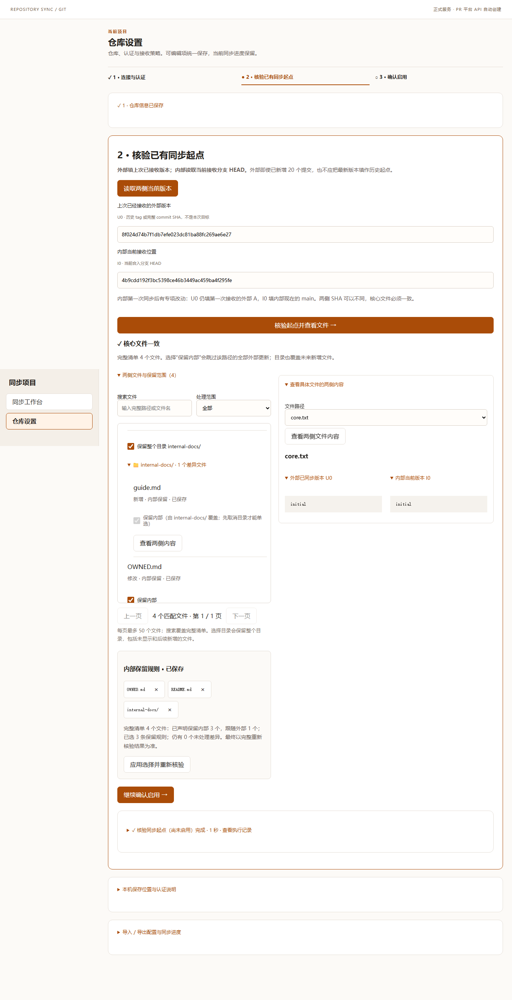

# 仓库同步工作台第二轮复审实施与验收

本次继续使用 PR #77 的原分支，保留侧栏、本轮清单、五阶段全景、手动展开和同页查看。范围是复审 R01—R05；没有新增同步协议、后台服务或三方合并。

## 取舍与实施

| 项目 | 处理 | 产品行为与保护范围 |
| --- | --- | --- |
| R01 撤销确认丢失 | 采纳并扩大同型检查 | 同一项目、仓库绑定、配置修订、交付、PR 地址和候选的同步重绘保留勾选；刷新或操作对象变化后重新确认。提交前消费确认，失败后也重新确认。确认不写入 sessionStorage；后端仍校验 confirmed、交付及 PR 地址。 |
| R02 撤销显示合入完成 | 采纳 | 撤销成功显示“已撤销、未合入”；合入观察、合入核验和登记接收显示不适用。撤销回执单独保留，不能作为 merged 证据。无当前交付、刷新后和历史记录采用一致语义。 |
| R03 首次配置偏长 | 分层采纳 | 第一步内分 A 仓库地址、B 认证与自动化；B 默认折叠，下一步或手动展开。三种凭据的用途并排说明；高级接口和身份仍折叠。保存后才做真实连接读取，连接结果前置展示。所有认证仍在初始配置中完成。 |
| R03 文件选择与对比距离大 | 采纳 | 桌面左侧文件树及保留规则、右侧所选文件内容；手机纵排。保留目录继承、明确保存、按需打开内容及文件身份防串读保护。 |
| R04 字号与 SHA | 采纳 | 阶段标题和业务摘要提高可读性；清单与提交概览用 12 位 SHA，支持复制完整值，技术证据保留完整 SHA。复制失败提供完整值和明确反馈。 |
| R05 过期恢复提示 | 采纳 | 同一轮次已完成、在两笔之间暂停或已撤销时清理恢复上下文，显示短结果提示；刷新后不再出现旧恢复卡。其他绑定、轮次或交付仍阻止恢复，避免操作另一笔。 |

不采用“所有内容强塞一屏”和刷新后自动沿用撤销授权。桌面尽量展示业务全景，展开正文允许合理滚动；手机保持可读纵排。显式确认只保护当前页面的未提交操作，刷新后需要再次确认。

## 根因与同型排查

1. 普通草稿明确排除了操作确认，但同步 DOM 重绘没有单独保留确认。补上仅在本次重绘内存中存在的确认保护；同时检查 PR 引用确认、撤销引用、关单规则确认。URL 改变会取消旧链接确认。私有配置启动没有 revision，原来空字符串与 undefined 的比较也会误判版本变化，现已规范化。
2. 流程投影把 cancel-pr 等技术任务的 DONE 当作合入成功。撤销任务与正常合入分组隔离，并为撤销终态设置业务步骤“不适用”；真实合入仍要求 mergeObservation 或 acceptedInternal。执行记录保存失败仍可显示异常，不能被撤销终态隐藏。
3. 恢复卡只检查能否继续，没有对原任务终态退出。增加限定原绑定与原轮次的终态清理；原本的迁移暂停、缺少认证和跨交付保护继续生效。
4. 配置分层的展开状态纳入已有按项目保存的手动展开机制，避免后台轮询把正在填写的认证区收起。没有把 Token 写入草稿。

## 验收矩阵

| 旅程 | 必须核对的结果 |
| --- | --- |
| 首次配置版本/过程模式 | 地址与必要认证在启用前完成；错误就近提示；高级项默认折叠；连接读取不创建 Issue/PR；下一主步聚焦基线。 |
| 基线文件差异 | 文件树选择、目录继承、显式保存；桌面并排/移动纵排；快速切换与慢请求不串文件；刷新后已保存规则保留。 |
| 撤销确认 | 勾选并失焦，连续三次真实状态轮询不丢；刷新后取消勾选；无确认不得关闭 PR；对象或配置变化不继承确认。 |
| 撤销异常恢复 | 模拟平台已关闭但响应丢失；刷新后回读原 PR，关闭次数不增加；接受基线保持不变。 |
| 撤销历史与重试 | 当前和历史第四阶段不能绿色合入完成，第五阶段不登记接收；明确继续才创建替代 PR，复用 Issue，保留旧记录。 |
| 真实合入 | 新 PR 人工或显式选择自动合入后，真实 Git/平台回读使第四阶段完成，再核验、关单与登记接收。 |
| 恢复入口退场 | 原轮次完成后清上下文；刷新无旧卡；其他项目/交付、缺少 Token 或迁移暂停时不得恢复错误对象。 |
| 可读性与复制 | 1366 桌面、390 手机无横向溢出；长 SHA 不挤业务文本；复制返回完整 SHA，失败可人工复制。 |

## 证据边界

浏览器验收使用隔离的真实 Git 仓库、真实本机 HTTP 服务，以及合成 GitHub/CodeHub 协议响应，不是用户内网平台权限验收。服务重启和进度恢复由持久化/恢复测试验证；正式试用入口复用现有服务，只更新兼容的静态资源，保留配置、项目和历史。所有作者测试服务按实例台账停止，合成数据与证据保留。

### 已执行验证

- 包目录执行 `pnpm build`、`pnpm lint`：通过。
- `node --test --test-concurrency=6 test/*.test.mjs`：395/395 通过。
- 相关浏览器程序包括 `operator-journey`、`process-setup-journey`、`setup`、`setup-flow`、`projects`、`connection-ux`、`recovery`、`auth-repair`、`development-retry`、`baseline-review`、`round-panorama`、`pause-boundary`、`workflow-phase-regression`、`auto-merge-settings`、`git-pr`、`version`，文件均位于包内 test/，后缀为 `-browser-check.mjs`；阶段回归用 `node --test` 执行，其余用 `node`。
- 针对 R01/R02 先观察到失败：轮询确认丢失、取消回执投影为合入完成；修复后回归通过。R05 在真实浏览器先复现已完成仍有恢复按钮，再修复通过。视觉检查发现两列布局压缩文件名，新增可读宽度断言后先红再绿。
- Biome、语法检查、文件 350 行上限及 `git diff --check`：通过。

[移动端纵向核验截图](../evidence/repo-sync/reaudit-baseline-vertical-390.png)

源代码提交号及浏览器最终汇总见本次 PR 实施回执。
