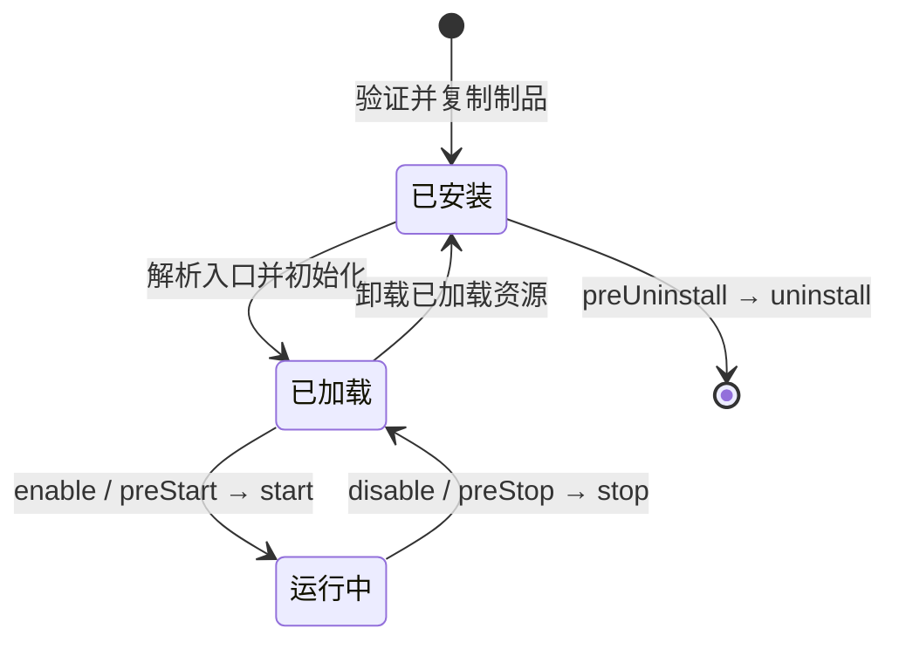

# 插件与 Host 接口基线

本页描述当前源码实现的公开接口。接口新增或行为改变必须与实现、类型及本页一同评审、验证；npm 可获取版本须另核发布记录。[项目布局、依赖、构建与安装](plugin-projects.md)。下列方法写作 SDK `FeatureContext` 形式；不用 SDK 的模块按同一契约实现入口，模块 Host 的消息发送接收 `{threadId, ...draft}`，SDK 封装成两个参数。

## 1. 身份与 Host client

Host 在安装时掌握 pluginId、安装实例、包版本／摘要和声明，并在加载时建立该实例的 client object。`context.pluginInstanceId` 与 `context.featureId` 由 Host 注入，仅用于归属；业务参数不另提交一份身份或签名。外部平台与线程、消息、成员的业务映射由插件保存，不成为第二份 Host 成员或消息目录。

Host 调用 action 时，将 `PluginActionContext` 作为 handler 第二参数传入：`catId/threadId/userId/invocationId/originTriggerMessageId?/source?/assertCurrent()`；owner 设置操作或 HTTP 请求使用第三参数 `PluginHostActionContext`，包含其调用类别、实例、请求事实、`signal/assertCurrent()`。输入正文不是身份来源。线程与消息接口遵循普通用户资源规则、调用上下文和实例存活；插件绑定不是额外的资源可见性规则。

同进程模块直接持有 Host 创建的能力对象。当前还实现了按 `runtime.transport` 声明启动的独立载体，其会话、身份与生命周期管理属于 carrier 内部。插件业务自行启动的 helper 子进程属于插件自己的 `start/stop` 资源，Host 不理解其 PID 或内部协议。

原生 MCP contribution 声明进程与环境，不声明 action 方法白名单。RPC 的 `method` 路由到模块实际导出的 `actions`；未知方法返回普通未暴露错误，token 只证明当前活跃实例与调用上下文。webhook、direct-tool、配置按钮等 `action.method` 仍用于各自的路由。

Contract `0.3.2-candidate.0` 起，具有 builtin 模块入口的插件可以在 MCP contribution 增加
`sharedFactory: { module: 'dist/mcp-server.js', export: 'createMcpServer' }`。
工厂接收 Host 为本次请求注入的 action client，返回可连接和关闭的 MCP server；stdio 入口应复用同一工厂。
导入工厂不得启动进程、监听端口、注册退出钩子或保存调用者身份。Host 继续验证当前安装、贡献和调用者，
并沿原 action 入口执行权限、取消和结果脱敏；包内处理器保留 schema refinement 和结果包装。
旧 stdio 声明必须保留作显式回退，受限调用仍走原载体。新声明要求相容 Host 和实际验证过的 SDK／Contract
依赖；旧 Host 可能在安装时拒绝新包，不能把保留 stdio 等同于旧 Host 可安装。

调用取消由实际载体的 `AbortSignal`、action 的 `assertCurrent()`、feature 撤销共同完成。未提供 signal 参数的方法依靠实例撤销／Host 方法检查；普通写操作不会因结果丢失自动重试，拒收晚到结果不等于已经发生的写入被撤销。`config/secrets.get` 每次读取当前有效配置；配置保存保持启用意图，运行实例通过 `configRefresh` 更新实际资源。

SDK 公开方法是接口边界，不再按插件 ID 或 feature 能力数组复制一张 API 授权表。新 manifest 与 SDK 绑定不含 API 权限清单；旧 manifest 字段在原解析入口忽略，旧握手额外字段只在 hello 兼容边界读取后丢弃，不回流新模型；普通功能与方法声明、包完整性、实例 token、owner／线程可见性及启用禁用检查保持。Host 侧的对应清理须兼容已安装旧包，不以升级插件为恢复前提。握手行的字节摘要描述当前规范消息；旧 Host 附带的惰性元数据不进入新 binding，原始传输仍受既有 NDJSON 帧大小上限约束。

## 2. Plugin → Host

本轮候选新增可选 `runtimeInfo.get()`：仅在当前安装的 owner HTTP 操作中返回当前 Host 版本/修订、系统、Node、默认项目和有效日志目录，不提供完整环境或配置；旧 Host / 不支持的载体可不提供。`threads.create({title, projectRef?, parentThreadId?, participants?})` 中项目目录引用由 Host 按普通项目策略校验，不能同时指定 parent 与 projectRef；省略两者沿用默认项目。线程投影的 `projectRef` 是 Host 解析后的真实项目。侧栏入口来自已启用安装包的 PDL console（`console/pdl.yaml`、`console/components`、`console/i18n`），图标来自插件元数据；页面从对应的已声明 GET webhook 获取标准 HTTP HTML，再交给 opaque iframe 隔离渲染，不另行调用 UI action 或使用 PluginUiPanel 信封。

参数与结果的完整类型以 [module-host.ts](../packages/plugin-sdk/src/module-host.ts)、[FeatureContext](../packages/plugin-sdk/src/feature-context.ts) 及相应类型入口为准。下表涵盖当前公开 surface；“实例”表示 Host 自动绑定的安装实例与 feature，不能由正文替换。

| 接口 | 用途、参数与结果 | 资源与身份边界 | 生命周期与取消 |
| --- | --- | --- | --- |
| `context.config.get(key)` | 读取当前配置，返回 unknown | 实例声明的配置 | 每次读最新值，撤销后拒绝 |
| `context.secrets.get(key)` | 读取声明凭据，返回 string 或 undefined | 实例声明的凭据 | 不把密钥写日志，撤销后拒绝 |
| `context.storage.get/list/set/compareAndSet/delete` | 私有键值；读返回 revision/value，CAS 接 expectedRevision，返回 applied/revision | 实例私有存储 | 持久数据按声明保留；并发用 revision；停用撤销调用 |
| `context.threads.get(id)`、`context.threads.list({limit,before}?)` | 普通线程摘要或 null／分页摘要，含 Host 生成 deepLinkUrl | 普通用户线程规则 | 实际资源检查、实例存活 |
| `context.threads.readMessages(id,{limit,before?})` | 分页历史 id/timestamp/content/sender；可选 response 提供 executionId/inputMessageIds/status/startedAt/completedAt，恢复漏掉的实时状态；游标用同一行的 timestamp/id | 普通线程可见性 | 同上，不把分页当永久快照；不暴露原生认证或会话元数据 |
| `context.threads.getCats(id)` | 实际参与者、当前可路由成员与未加入成员事实 | 普通成员与线程可见性 | 实际线程参与者，不是插件自建成员目录 |
| `context.threads.create({title,parentThreadId?,participants?})` | 创建普通线程；父线程存在时继承项目；返回摘要 | 普通用户线程写入规则 | 写失败不自动重试；成功后业务绑定由插件 storage 管理；响应异常后允许重新创建并覆盖映射 |
| `context.threads.update(id,{title?,preferredCats?})` | 修改标题或偏好，返回摘要 | 普通用户线程写入规则 | preferredCats 是偏好，不等同实际参与者 |
| `context.threads.addParticipants({threadId,catIds})` | 添加实际线程参与者，返回摘要 | 普通用户线程写入规则 | Host 复用成员与线程资源校验 |
| `context.members.list()`、`context.members.get(catId)` | 同一成员目录的列表／单行或 null；catId/displayName/defaultModel/available，及可选 nickname/variantLabel/roleDescription/avatar | 当前实例与普通成员目录 | available 是 Host 的成员启用/可用状态，当前与成员设置的启停开关同源；不证明实时额度、Provider 在线或某插件操作受支持，实际调用仍由 Host 判断 |
| `context.messaging.get(messageId)` | 标准 PluginMessage 或 null，正文、结构化块、来源 meta、时间及修订 | 普通用户消息可见性 | 消息元数据是数据，不能制造权限 |
| `context.messaging.send(threadId,draft)` | 保存可见消息，返回 messageId/threadId；可声明 identity、replyTo、媒体及 wake:auto／catId | 声明身份；当前实例与目标线程 | 普通入站 send+wake 一次完成；按 idempotencyKey 重放原写入 |
| `context.messaging.subscribe(threadId,options?)`、`unsubscribe(threadId)` | 声明允许的消息订阅／撤销；options 含 contributionId/includeOwnMessages | 声明的订阅 contribution 与方法 | 与实例启停绑定，消息回调见下一节 |
| `context.streams.read(reference,{signal}?)` | 将获准 `hmr_…` 附件引用读取为 AsyncIterable<Uint8Array>；用于平台上传／转发附件 | 当前实例和附件引用范围 | 直接 AsyncIterable 字节流；结束／return／abort 只释放 reader，引用由 owner 保留，可重试；撤销后停止读取 |
| `context.tasks.get(selector)`、`context.tasks.list(filter)` | selector 为 {id} 或 {subjectKey}；filter 可含 threadId/kind；get 返回 Task/null，list 返回 Task 数组；可含 entrustedWork 只读摘要；dataController 的 currentForCaller 是 Host 针对当前实例、lifecycle 与 Work 绑定 计算的即时 fence，不是持久授权 | 当前用户可见的 Task | 数据不等于执行授权；实际请求受实例生命期约束；controller state=active 但 currentForCaller=false 时不得维护、发送或唤醒该 Work，只能经新的 owner-confirmed bind 接续 |
| `context.tasks.create(input,options?)`、`context.tasks.update(id,patch,conditions?)` | create 默认 onConflict:error；create 的 onConflict:update 要求非空 subjectKey 并保留原子 subject 确保；update 的 expectedThreadId、entrustedWork.expectedRevision、wait.expectedGeneration 均由 Host 内部原子核验；create 返回 Task，update 返回 Task/null | 当前 Task／线程、CAS 与 canonical entrustedWork admission；数据写入不派发执行 | wait patch 不与普通字段或 entrustedWork 混合，写前拒绝且不拆成两次写；无自动写重试，不派发执行 |
| `context.tasks.bindDataController(input)`、`context.tasks.revokeDataController(input)` | 用 exact Task/revision、不可变 Work 快照与幂等 operationId 建立或撤销有界数据维护绑定；返回 Host receipt、binding revision 与同一 Task | Host 注入当前实例／模块／绑定坐标及 owner 明确确认，包不能提交可信 actor、confirmed 或 controller 坐标 | 每次调用在同一 inventory 串行边界内复核实例、lifecycle、数据维护绑定与 Task CAS；旧 Host 缺少 typed port 时明确 unavailable，绝不 fallback create；绑定只授权同一 Task 的数据维护，不授消息发送、wake 或外部 Service 权限 |
| `context.dataPath` | Host 启动上下文注入的稳定实例数据目录 | 实例；路径复用 runtime.dataDirectory 声明 | 插件管理内容，卸载按声明的数据策略处理 |
| `context.log(level,message,fields?)` | 输出诊断；日志字段由调用者显式提供 | 实例 | 不输出密钥；作用域随 feature 生命周期 |

模块 Host 可向经验证的 Collective 安装实例提供可选 `collectiveArtifactOwner` 接缝，结构见 [owner port 类型](../packages/plugin-sdk/src/collective-artifact-owner.ts)。它不属于通用 FeatureContext，不是内容 CRUD：Host 保留内容／审核／媒体／custody 状态，绑定 activation 并逐次复核来源授权；尚未 compose 时明确 owner_unavailable，可重试。

## 3. Host → Plugin

| 接口／调用 | 输入、结果与用途 | 身份、声明与取消 |
| --- | --- | --- |
| `entrypoint.create(manifest)` | 建立已加载 module 对象，返回 start 及可选生命周期／settings hooks | Host 核安装包与声明；不是启用动作 |
| `module.settings(host)` | 已加载模块的配置／扫码动作，返回 actions 和可选 dispose | Host 绑定实例与 owner 设置调用；不执行业务 start、不更改 enabled 意图 |
| `module.start(host)` | 启用业务；返回 actions、configRefresh、preStop、stop 及可选 deliver／handle／webhook／streams | 已声明 feature，Host client 绑定实例；拒绝启动则不宣称 healthy |
| `actions[method](input,actionContext?,hostContext?)` | 工具、配置按钮、测试、schedule、service 或声明 HTTP 请求；返回其已声明结果（包括 render/data/targetValues/advance） | 实际导出的 handler 按 method 路由；上下文由 Host 注入；signal/assertCurrent 与停止撤销 |
| 单一 delivery action | kind 为 message 或 execution_status；公共 deliveryId，执行反馈按 executionId 关联；message 携带 envelope，status 携带 started/blocked/resumed/settled 等状态及 presentation | 声明的 message-subscription 方法；receipt 只确认本 input 处理，不能推断猫执行成功；deliveryId 幂等 |
| `activation.deliver(input)` | 固定的 Host→插件消息入口；输入为 PluginDeliveryInput，message 由 reason 区分 addressed／subscription，回执为同一 deliveryId | `call` 只声明可被呼叫及展示信息；Host 决定调用接口，插件不能选择方法名；停止后撤销 |
| `activation.handle(request)` | Host 验证安装 token 后转发的外部请求；插件自行解释业务协议 | 不注册为普通 Agent MCP，也不暴露方法白名单；token 只绑定安装实例 |
| `activation.webhook.handle({contributionId,request},hostContext?)` | 固定的声明式 HTTP 入站；contributionId 选择插件自己的 webhook 资源 | 仅无 action 的已声明 webhook 且 runtime 实际实现时存在；Host 负责路径、方法、body 上限与身份；插件不能选择 Host 方法 |
| `activation.configRefresh()` | 插件按需声明；配置改变后重读 config/secrets、更新自身连接与缓存；没有 hook 时无操作 | Host 校验实际资源与实例存活；刷新失败旧 handler 不继续执行，由管理器记录 error |
| `activation.streams.read(reference,{signal}?)` | 与 Plugin→Host 相同的 AsyncIterable<Uint8Array>；Host 读取插件提供的附件 | 静态 media-source 声明来源归属；结束／return／abort 只释放本次 reader，不删除附件或使引用失效 |
| `activation.preStop({reason,deadline})`、`stop({reason})`／settings `dispose()` | 排空／停止该次运行／释放设置资源；deadline 是 Unix 毫秒 | Host 控制生命周期，插件回收自己的连接、订阅、定时器及 helper 子进程 |

### 管理生命周期



| 阶段 | Host 保证与实际 hook | 插件职责 | 失败落点 |
| --- | --- | --- | --- |
| 安装 | 验声明／版本／摘要，复制不可变安装制品并记录 inventory；当前没有 install hook | 提供完整制品、入口、声明及数据策略 | 不准入或保留安装失败，不能伪报已启用 |
| 初始化／加载 | 加载入口、`create(manifest)`，建立实例 client；按需调用 settings | 只建立所需对象与设置 handler，不把初始化视为启用 | loaded/settings error；不能先启动业务再假装初始化 |
| 启用／启动 | 按启用意图调用 preStart(host)／start(host)，登记实际激活状态 | 建立业务连接、订阅；自行启动所需 helper 子进程 | 启动失败为 error／blocked 等实际状态，清理部分资源 |
| 停止／禁用 | 停止接新调用，preStop({reason,deadline}) 后 stop({reason})；保留 disabled 意图 | 中止未完成操作，停止自身定时器／连接，回收自建子进程 | 记录真实停止错误；晚到回调不能恢复活性 |
| 卸载／销毁 | 运行时先 preStop／stop；随后 preUninstall(host)／uninstall(host)，移除安装并按数据策略处理；停用实例直接用 settings 同型 host 执行卸载，不调用 start | 停止阶段已释放运行资源；不自行删除用户保留数据 | 保留实际失败记录，不凭目录消失伪造成功 |

停用状态仍可读取／编辑／保存正常配置及执行声明设置动作；保存不自动启用。已启用实例保存配置时保持启用意图，调用 configRefresh；没有 configRefresh hook 时不执行隐式 stop/start；缓存配置或持有连接的插件显式实现刷新，重读配置并替换自身资源。刷新失败由 Host 停止旧 generation。卸载上下文仅 pluginInstanceId/dataPath/config/secrets/storage/log，不授予运行能力。插件自建 helper 的 PID 与协议不属于 Host 管理接口；现存 external-runtime 则是 Host 运行插件载体的实现事实。插件界面见下文“控制台界面与富卡片”，`console/pdl.yaml` 声明包内控制台。

`test` 是任意命名的普通 action。所有 action 返回的图像、轮询 data 和 receipt 都只用于本次显示，不由 Host 持久化或恢复。Host 仅保存通用步骤位置和 manifest 声明的配置／凭据目标；业务 cursor／二维码 challenge 由插件 storage 或既有不透明业务引用持有。操作 receipt 不能恢复为 runtime 健康状态；配置改变、重新安装或新操作使旧结果失效，晚响应不得覆盖更新结果。普通配置与操作顺序按 manifest。runtimeState 的 healthy/degraded/crashed 是载体健康，不是微信登录或外服连通；healthy 与插件 idle 可以同时成立。操作回执不改变这份投影。

模块 Host 另可提供 `host.messaging.findSent({threadId,idempotencyKey})`。它只查本实例、当前用户的原始持久消息与已准入 Queue 目标，返回 `{messageId,threadId,content,routedCatIds}` 或 `null`；不是执行完成或已读回执。恢复未知发送时，先核原正文和目标，再决定是否沿原请求继续；不得用短期 transport ledger 过期作为重新发信理由。旧 Host 可能没有此方法，依赖永久幂等恢复的插件应明确暂停。该入口目前属于 module Host，不宣称 stdio 或 feature-context 已支持。

SDK `0.3.0-beta.2-candidate.13` 候选读取器支持 Host 消息的可选 `from`：真人是 `{kind:'user',userId}`，成员是 `{kind:'agent',catId}`，外部、插件、系统来源仅投影 `{kind:'external'|'plugin'|'system'}`，不接收其私有安装、地址或服务标识。该事实经过严格校验、复制和冻结；`source` 等展示字段不能替代可信来源，也不提供执行授权。旧 Host 可以不返回 `from`，需要可信作者的业务必须明确拒绝缺失，不能从展示身份补猜。线程摘要另有可选 `createdBy`，可读不等于属于当前用户。原消息可见性、撤权期间拒绝晚到读取与未知字段拒绝保持。

需要确认指定真人作者时，消费方须要求 `from.kind === 'user'`，并将 `from.userId`、`message.userId` 与预期 owner 一并核对；SDK 只校验 `from` 的结构，不做上述交叉校验。

跨仓验证可设置 `CLOWDER_HOST_API_SRC` 为对应 Host 的 `packages/api/src` 绝对路径，再运行 SDK 的 `src/message-read-host.test.ts`；它直接调用真实消息投影和 SDK feature 读取器，使用合成 Store，不启动服务或调用提供方。普通 SDK-only checkout 明确跳过这一项，消息模块与非法来源测试仍正常运行。依赖方应在 SDK 新版本真实发布后锁定 registry tarball/integrity；源码候选不代表已经可从 npm 取得。

Host 增加消息投影字段时，应先发布兼容的 SDK 并升级消费方，再上线 Host 新字段，避免封闭键集的旧读取器拒绝整个消息。

需要保留具体接收者的 module 发送可用 `wake:{catId,exact:true}`。目标失效时拒绝该次唤醒，沿原幂等键恢复，不能回退其他成员；原有 `wake:{catId}` 继续使用普通对话路由语义。`findSent` 的目标合并当前 Queue 与原消息 History 投递记录，Queue 已消费不代表原目标消失；可选 deliveryStatus 为 canceled 时不可重新发送该原消息。

模块 Host 的可选 `host.memberSessions`（SDK `0.3.0-beta.2-candidate.5` 候选类型）承接受限成员执行；旧 Host 或缺少持久化支持时可以不提供，插件应明确暂停，不能退回普通工作线程或只读工具模式。`create(input)` 由 Host 创建独立线程并准备授权；`prepare(input)` 仅续接本实例已创建的受限线程；两者与 `revoke(sessionId)` 都只接受 Host 认证的当前 owner 操作上下文，正文没有批准字段。输入只含真实成员、已声明 MCP/identity、现有账号引用及已批准记忆引用，不含 key、登录态、任意工作目录或模型替身。返回的 summary 记录真实 client/model/carrier/authType/accountRevision、授权 generation、已消费语义游标，以及可选 Host activationId。

模块 Host 的可选 `host.ownerChat` 从 `0.3.0-beta.2-candidate.7` 声明当前原生调用的主人 Chat 来源。`await host.ownerChat.capture()` 不接受来源参数，返回只读 `origin:{messageId,threadId,helperCatId}`、异步 `assertCurrent()` 和同步 `assertWriteCurrent()`；不返回正文、token 或通用授权凭据。Host 核验原 canonical 主人消息、可见性、当前 invocation/安装及工具策略，受限玩家、只读来源、adopted wait、撤回消息和失效调用会被拒绝。旧 Host 未提供此端口时应明确报告不可用，不借浏览器 owner-operation context、userId 或正文自称批准替代。

这个 handle 只在同一进程、同一原生 action 生命周期内有效：异步工作后重查 `assertCurrent()`，实际同步提交前立即调用 `assertWriteCurrent()`，两者之间不跨新的 await。原 action 返回、撤权或停用后必须拒绝写入；不要持久化/序列化/跨调用复用 handle。来源坐标可以作为已有业务记录的审计事实保存，但坐标本身不授予权限。该端口不替插件判断用户具体想做什么、不选业务目标、不提供物理动作或创建第二套权限账本。使用前核对实际 registry 发布版本与 Host 支持；候选源码合入不等于已发布或已启用。

`execute({sessionId,generation,executionId,semanticCursor,content})` 只消费既有授权。原 executionId 与完整输入绑定，未知结果沿原 ID 查询／续接；成功只能来自同一原消息的 canonical 子执行、响应与 provider teardown，不由插件正文或 CLI session ID 宣布。`get(sessionId)` 读取授权摘要；`getExecution({sessionId,generation,executionId})` 读取原有持久回执，也可在撤销／续接后读历史 generation，不发送消息、不唤醒、不恢复执行权限。安装停止、激活版本变化、账号或记忆修订变化会阻止旧行动；新的 owner 操作可以续接同一线程并升授权代次。游戏角色代次和业务动作由插件自己的权威服务负责，不由这个通用 Host 端口替代。该接口只属于 module Host，未声明 stdio、settings-only Host 或 feature-context 支持，也不意味着任一 provider 的受限载体已经可用。

实现参考：[SDK 类型](../packages/plugin-sdk/src/module-host.ts)、[feature 生命周期](../packages/plugin-sdk/src/feature-context.ts)、[消息／控制 wire registry](../packages/plugin-contract/src/wire/index.ts)、[模块 action client](../packages/plugin-sdk/src/module-action-client.ts)。wire registry 说明载体消息，不替代以上作者 API。当前 stdio 的 Host 发起请求只有 `host.lifecycle.ping` 和 `host.messaging.deliver`；生命周期 hooks 由 module 载体直接调用，不是额外 stdio 方法。`streams.read` 在 stdio 内部分片传输，作者仍读取 Uint8Array 迭代器。

### 插件面板挂载与业务 HTTP

包内 PDL console 提供入口与面板，通过插件声明的 webhook 路由访问页面和业务。页面 HTML、资源和业务请求统一使用既有 `/api/plugins/:pluginId/*` 分发及 `{...action.params, request}` 参数语义；页面以 `text/html` 返回，不建立另一个 UI 请求协议。opaque iframe 通过受当前插件命名空间和挂载代次限制的 HTTP 桥访问这些声明，重定向被拒绝。独立服务的页面和请求仍由插件自己的服务负责，不由 Host 增设业务协议。

例如反馈插件 的 `feedback.page` 声明处理 `GET panel`；`feedback.http` 处理 `POST feedback`，内部业务读取 `input.request.body`。两者均返回既有 status/headers/body 结构；控制台 frame 从 `GET panel` 获取 HTML，页面经通用 HTTP 桥调用 `POST feedback`；保留的 `feedback.panel-route`（`POST feedback/panel`）仍由插件处理。超过普通响应预算的已保留截图通过通用流响应交付。Host 与插件桥接修订需要配套采用，这不代表候选公共 UI 方向已经获得维护者采纳或发布。

### 项目产物交付候选（未发布）

`0.3.1-candidate.0` 在当前 `0.3.0` 契约上准备了 `projectOutputs` 有界产物声明。它是待审候选，尚未获得项目产物公共交付范围的采纳或发布批准；不恢复已退役的 API 权限表或原生 MCP 方法白名单。SDK 的对应上下文类型位于 `0.3.0-beta.2-candidate.0`。

每条声明给出公开 action、内部 producer/lookup 方法、同 feature 的 `mcpId` 和 media-source、允许的 MIME 和大小上限。这是产物操作的资源归属与生命周期声明，不是通用 API 访问清单。首版仅接受可解析可信调用上下文的原生 MCP 入口，不接受 direct-tool 或设置动作；Host 拦截产物公开 action，并拒绝普通调用直接触发该声明的内部 producer/lookup。调用正文为 `{requestId, outputPath, parameters}`；Host 从认证调用解析用户、线程和项目，在实际安装、显式启用、当前调用与项目归属检查下，将完整音频／回执目标一起独占预留并持久记录，再调用 producer。producer 仅收到 `parameters`，第二参数带 Host 注入的 `outputOperation.id`；它不收到项目绝对根或 writer。旧 Host 必须在安装或调用之前拒绝，不能先生成后退回附件。

producer 和 lookup 返回同一个有界 `ProjectOutputResult`：`pending`、`generation_unknown`、`rejected` 或 `produced`。后者含归属 PMR、媒体类型、字节数、SHA-256 和来源事实。插件在返回引用前持久保存产物；Host 复用现有媒体 ledger 承接字节，并验证完整性、实例／来源归属和当前权限后交付。Host 控制回执文件名、序列化和归属字段，只有两个文件均持久完成才返回 `delivered`。

相同 `requestId` 与相同参数接续原操作；不同参数拒绝。派发后结果未知不得再次调用 producer；恢复只查询原结果或继续交付。授权撤销、目录变化、外部文件占位与磁盘失败不能变成覆盖或付费重试。多个普通文件的依次提交不宣称整体原子性；崩溃按原预留 inode、内容摘要及前缀恢复。插件与 Host 承接的用户产物都不随停用、升级或卸载丢弃。

设置动作可返回 `render: url, data: {url}`，由 Host 显示仅 HTTPS、无内嵌认证的链接；不自动打开浏览器。轮询可携带同一 `data.url` 供刷新后的卡片恢复显示。Google 等具体来源的固定域名和授权参数校验仍由插件负责。Host 设置结果不接受 `ok`；只读 `test` 则返回 `{ok, message?, details?}`，二者不可混用。

## 控制台界面与富卡片

控制台由已安装包内的 `console/pdl.yaml`、`console/i18n/<lang>.yaml` 和可选的 `console/components/*.js|css` 组成。`console/pdl.yaml` 直接保存 PDL 对象（如 `ns`、`inserts`、`views`、`requests`、`replaces`），不包裹 `pdl` 键。

Host 从该目录读取控制台；`plugin.yaml` 不声明 `pdl`，插件 runtime 使用已发布 SDK 的 manifest 契约独立校验。将 `console` 列入 `package.json` 的 `files`，使声明、翻译及组件一同发布。翻译文件按语言命名，供 `t:<键>` 引用；组件 JS/CSS 由 Host 从目录加载。宿主不加载控制台应用脚本。

业务接口由插件实现并在 `contributions` 中声明为 webhook，同时归入对应 feature。Host 只按声明转发 `/api/plugins/<pluginId>/<path>`。

按需要选择：

1. **仅 PDL**：入口、列表、设置、表单、弹窗已有合适组件时，直接组合组件；接口直接返回组件所需的数据。
2. **PDL + 自有组件**：已有组件不能表达画法时，在 `console/components` 提供纯绘制函数和 CSS；读取、写入、状态和动作仍写 PDL。
3. **frame**：已有独立页面、复杂编辑器或完整应用需要自行管理内部交互时，用一个 frame 节点。内部不能被宿主插入节点；与宿主交互受 bridge 限制。

### 容器、入口与组件契约

运行中的 Host 在 `/pdl/plugin-catalog.json` 发布随版本生成的目录：容器与公开锚点、作用域、组件属性与变体、公开动作与数据源。以目标 Host 的目录为准，不复制私有 view model 或动作。

`inserts: [{ id, anchor, at, node }]` 将节点放进同一棵树；`at` 是 `before | after | inside`，必要时用 `with`、`depth`、`fallback` 限定位置。插件内 id 必须唯一且跨版本稳定，宿主登记为 `plugin:<pluginId>/<id>`。行作用域节点只能进入行容器。入口上的 `open: { node, as, anchor, depth }` 决定打开位置：`cover` 覆盖、`beside` 并排、`float` 浮层；目标在 `views` 登记，浮层壳在 `popups` 声明。容器提供的作用域数据决定节点能读什么。

组件按目录契约接收数据、动作和事件；`when` 决定显示，`disabled` 可绑定 `$.pending`。新增画法的注册形式是：

```js
PDL_COMPONENTS['plugin:example.plugin/summary'] = function (b, sc, root) {
  // 只根据声明和传入的数据绘制，文本必须转义，样式只用主题 token。
  return '<div class="plugin-summary"></div>';
};
```

在 PDL 中用 `{ type: component, use: 'plugin:example.plugin/summary', props: ... }`。组件不能读数据、发请求、读写宿主状态或登记业务动作，也不能修改已有组件。

全局替换宿主组件用 `replaces: { <宿主块类型>: { use: 'plugin:<pluginId>/<name>', props: [...] } }`；`props` 必须列全该类型在目录中的属性，输入形状、动作和事件语义也必须保持。一个宿主组件同时只能有一个启用中的替换者；冲突时安装可完成，但启用被拒绝并指出组件与占用插件。停用恢复宿主画法。有 `replaces` 时组件随索引加载，其余组件随首次投影的子树加载。

### 读取、写入与宿主能力

`requests` 给插件内的请求命名，每项是 `{ path, method?, query?, body? }`；默认 GET。参数值可以是字面量、`state.<键>`（插件视图状态）、`@字段`（当前输入数据，可带路径）或 `host.origin`。复杂输入可用 POST body 传递。不要把宿主的 `/api/plugins/...` 前缀写进 `path`。

节点用 `sources: { list: listRequest }` 声明来源。投影时读取，结果放在 `$.list`，读取状态在 `$.load`（`loading | error | ''`）；同一来源不按组件重复读取。角标可直接写 `badge: $.list.count`。后端负责筛选、整形、可执行条件及打开目标，不能在组件里补一个 view model。

`plugin { request, ...参数 }` 调用声明的请求；`body` 中的 `@字段` 从动作参数取值。输入字段用 `change: plugin` 保存，不按键发送。`plugSet { k, v }` 改插件视图状态，用于搜索和翻页；引用该状态的请求随之重读。写入期间 `$.pending` 为真；写后宿主重读已投影来源。结果的 `message` 用于提示，失败显示错误；成功结果可带一个公开宿主动作 `{ act, args }`，由宿主在写后执行。需要确认或多个输入时，使用 `dlg.<kind>` 视图的 `fields`，每个字段写 `arg`，确定动作由 `okAct` / `okArgs` 声明；表单每次打开都是新的，不存进插件状态。

当前目录的公开动作是 `thread`、`go`、`insert`、`toast`、`copy`、`open`、`close`、`openUrl`、`dialog`、`plugin`、`plugSet`、`bindRetry`；公开数据是 `members`、`threads`、`currentThread`，写成 `sources: { members: 'host:members' }`。参数与返回形状应核对对应版本实现和目录；不要把公开名字理解为任意宿主能力。未公开的动作、`vm` 或数据源会在登记时被拒绝。

### 例：Quick Phrases 的 PDL 读写与插入

真实接口在 `packages/quick-phrases/src/phrases.ts`：GET `phrases` 接受 `q`、`page`，返回列表、分页位置及前后页；POST `{ text }` 保存，DELETE `{ id }` 删除。点击一条只发一次 POST `{ id }`：后端先记录使用次数，成功后返回 `{ ok: true, act: 'insert', args: { into: 'chat-input', text } }`，文字来自已保存用语。宿主随后执行这个公开动作，失败不插入。新增通过对话框填写；成功后返回公开的 `plugSet` 动作将页码重置为 1，表单随对话框关闭而清空。

以下为包内实际声明（省略身份与 runtime），搜索和分页只使用插件视图状态，列表及分页条件由后端提供：

包内 `plugin.yaml`：

```yaml
contributions:
  - type: webhook
    id: quick-phrases.entries
    path: phrases
    methods:
      - GET
      - POST
      - DELETE
    action:
      method: quick-phrases.entries
features:
  - id: quick-phrases
    name: 快捷用语
    resources: []
    contributions:
      - type: webhook
        id: quick-phrases.entries
```

包内 `console/pdl.yaml`：

```yaml
ns: quickPhrases
inserts:
  - id: quick-phrases
    anchor: chat.composer.tools
    at: inside
    node:
      title: t:quickPhrases.title
      icon: bolt
      scope: page
      open:
        node: quickPhrases.pop
        as: float
popups:
  quickPhrases:
    at: trigger
    exit:
      - outside
      - esc
views:
  quickPhrases.pop:
    bare: true
    popup: quickPhrases
    loading: t:quickPhrases.loading
    error: t:quickPhrases.error
    blocks:
      - type: pop
        label: t:quickPhrases.title
        pos:
          up: true
          span: 4
        blocks:
          - type: search
            id: qp-q
            placeholder: t:quickPhrases.search
            value: $.state.q
            input: plugSet
            args:
              k: q
          - type: list
            from: $.phrases.items
            empty: t:quickPhrases.empty
            row:
              title: "@text"
              act:
                of: $.pending
                map:
                  "true": ""
                  "false": plugin
              args:
                request: pick
                id: "@id"
                plugin: official.quick-phrases
              cols:
                - w: ctl
                  control:
                    type: button
                    iconOnly: true
                    icon: delete
                    label: t:quickPhrases.remove
                    act: plugin
                    args:
                      request: remove
                      id: "@id"
                    disabled: $.pending
          - type: toolbar
            when: $.phrases.paged
            items:
              - type: button
                iconOnly: true
                icon: prev
                label: t:quickPhrases.prev
                act: plugSet
                args:
                  k: page
                  v: $.phrases.prevPage
                disabled: $.phrases.first
              - type: text
                text:
                  t: quickPhrases.page
                  args:
                    - $.phrases.page
                    - $.phrases.totalPages
              - type: button
                iconOnly: true
                icon: next
                label: t:quickPhrases.next
                act: plugSet
                args:
                  k: page
                  v: $.phrases.nextPage
                disabled: $.phrases.last
          - type: button
            label: t:quickPhrases.add
            act: dialog
            args:
              kind: quickPhrases.add
            disabled: $.pending
    sources:
      phrases: list
  dlg.quickPhrases.add:
    title: t:quickPhrases.add
    fields:
      - id: qp-add
        arg: text
        label: t:quickPhrases.add
        req: true
    okAct: plugin
    okArgs:
      request: add
requests:
  list:
    path: phrases
    query:
      q: state.q
      page: state.page
  add:
    path: phrases
    method: POST
    body:
      text: "@text"
  pick:
    path: phrases
    method: POST
    body:
      id: "@id"
  remove:
    path: phrases
    method: DELETE
    body:
      id: "@id"
```

### 例：Feedback 的 frame 与 HTTP 桥

真实后端 `packages/feedback/src/index.ts` 的 `feedback.page` 处理 GET `panel`，以 `text/html` 返回现有完整页面；`feedback.http` 处理 POST `feedback`，内部业务读取 `input.request.body`。两者使用既有 status/headers/body 响应。下面的声明与包内面板一致，沿用可拖动、×／Esc 关闭的 float：

包内 `plugin.yaml`：

```yaml
contributions:
  - type: webhook
    id: feedback.http
    path: feedback
    methods:
      - POST
    requestBodyLimitBytes: 15728640
    action:
      method: feedback.http
  - type: webhook
    id: feedback.page
    path: panel
    methods:
      - GET
    action:
      method: feedback.panel
features:
  - id: feedback
    name: 问题反馈
    resources: []
    contributions:
      - type: webhook
        id: feedback.http
      - type: webhook
        id: feedback.page
```

包内 `console/pdl.yaml`：

```yaml
ns: feedback
inserts:
  - id: feedback
    anchor: inbox
    at: before
    node:
      title: t:feedback.plugin.entry
      icon: msg
      open:
        node: feedback.panel
        as: float
popups:
  feedback:
    at: trigger
    exit:
      - x
      - esc
    drag: true
views:
  feedback.panel:
    type: frame
    html:
      request: panel
    popup: feedback
    title: t:feedback.plugin.entry
    loading: t:feedback.load.loading
    error: t:feedback.load.error
requests:
  panel:
    path: panel
```

页面无需修改。宿主将 frame 的 `window.name` 设为 nonce；页面按现有 `ui/bridge.js` 协议发送请求：

```js
parent.postMessage({
  channel: 'clowder-plugin-ui/v1', nonce: window.name, requestId: 1,
  type: 'http', request: { method: 'POST', path: 'feedback', body: { op: 'bootstrap', resume: true } }
}, '*');
```

宿主将 `http { method, path, body }` 转发到此插件自己的路由，返回同一 nonce、requestId 的 `{ result: { status, body } }`；桥自身失败则回 `{ error }`。页面校验 source、channel 和 nonce，并处理超时。`clipboard.text { value }`、`clipboard.image { value }` 走平台剪贴板；`close` 关闭当前节点。页面用 `close.guard` 登记离开守卫；宿主在 ×、Esc、返回或替换前发送 `before-close`，页面保存草稿后回 `close`，保存失败回 `close.cancel` 留在原处。

`html` 页面由 Host 加 CSP 并放入 `sandbox="allow-scripts"`：不能联网、提交表单、开子框，图片只允许 data/blob，不能直接访问宿主 DOM。独立地址页面使用 `src: { request: client }`，请求返回 `{ src }`；例如 Collective 的 `console/client?hostOrigin=<host.origin>`。`src` 页面当前使用 `allow-scripts allow-forms allow-same-origin`，必须按部署的 frame / bridge 契约交互；`bridge` 声明不能扩展通用消息处理器。

消息富卡片使用 `kind` 与 `meta.kind` 声明 `card.<subtype>`，新的 subtype 以插件命名空间开头。通过 `templates` 为渲染类型登记节点，节点照样用 `sources` 和公开动作。带 subtype 的消息也必须有普通卡片的标题与正文，插件停用或缺失时才能逐级降级。

## 契约边界验证

Contract 的 schema、公开类型和 wire registry 是同一份接口真相；SDK 和独立 Loopback fixture 消费相同的契约夹具，不各自复制一套常量或方法矩阵。协议字节上限从允许的输入形状推导，并以合法最大值和 N+1、UTF-8 多字节与转义字符重新计算验证。请求与响应关联、错误结果、取消及授权撤销也须覆盖；测试通过不表示 Host 已支持或已启用该能力。


## Dot 迁移配套候选声明

本候选对应 Contract `0.3.3-candidate.1` 与 SDK `0.3.0-beta.2-candidate.12`。这是待审源码与制品的配套关系，不是已发布 npm 版本或旧 Host 兼容性的承诺；发布状态须另核注册表与 release 记录。

- 可寻址插件声明顶层 `call`（例如 `{alias: 'dot', displayName: 'Dot'}`），并实现固定的 `activation.deliver(PluginDeliveryInput)`。`call` 不接受包提供的 Host 方法名；输入的 `reason` 区分 addressed 与 subscription，回执 `{deliveryId}` 只确认接收。实例、源消息、寻址和可见性由 Host 验证；需要报告回复结果时，经消息发送接口明确提供对应的 response，不能以 transport ACK 推断完成。
- Dot 的旧数据 importer 是包的 `./migration` 导出，由 Host 的受限兼容适配器在启用前经 owner-operation 调用。它不是公开 manifest 字段、action、MCP 工具或 webhook 授权；批次只接收明确记录与原图字节，不接收服务端文件路径。一般插件不应声明 `migration.method`。
- webhook contribution 的可选 `requestBodyLimitBytes` 为正安全整数，缺省 1 MiB，上限 15 MiB。Host 消费要求是在 body stream／preParsing 阶段按已解析的声明早拒绝，超过限额返回 413 且不调用 action；未知目标和无声明目标保持 1 MiB。声明不改变 anonymous／owner 身份规则或请求头剥离。默认值与硬上限从 schema 生成的 `PLUGIN_WEBHOOK_DEFAULT_REQUEST_BODY_LIMIT_BYTES`、`PLUGIN_WEBHOOK_MAX_REQUEST_BODY_LIMIT_BYTES` 读取。

Dot 的 dot-mcp 声明 15 MiB，容纳既有 10 MiB PNG 的 base64 与 JSON-RPC 封装。其他插件保留自己的精确依赖版本与默认请求预算，不为此迁移强制升级。
