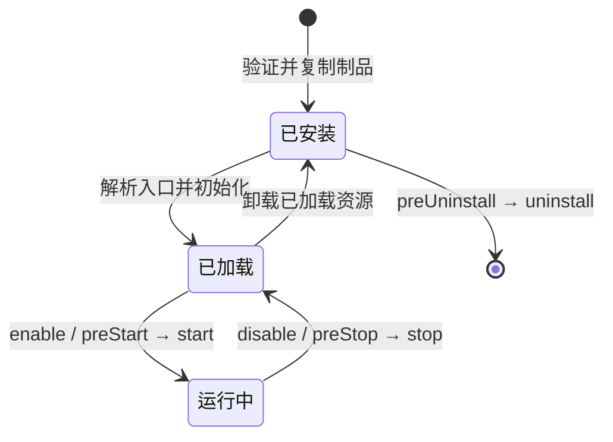

# 插件与 Host 接口基线

本页描述当前源码实现的公开接口。接口新增或行为改变必须与实现、类型及本页一同评审、验证；npm 可获取版本须另核发布记录。[项目布局、依赖、构建与安装](plugin-projects.md)。下列方法写作 SDK `FeatureContext` 形式；不用 SDK 的模块按同一契约实现入口，模块 Host 的消息发送接收 `{threadId, ...draft}`，SDK 封装成两个参数。

## 1. 身份与 Host client

Host 在安装时掌握 pluginId、安装实例、包版本／摘要和声明，并在加载时建立该实例的 client object。`context.pluginInstanceId` 与 `context.featureId` 由 Host 注入，仅用于归属；业务参数不另提交一份身份或签名。外部平台与线程、消息、成员的业务映射由插件保存，不成为第二份 Host 成员或消息目录。

Host 调用 action 时，将 `PluginActionContext` 作为 handler 第二参数传入：`catId/threadId/userId/invocationId/originTriggerMessageId?/source?/assertCurrent()`；owner 设置操作或 HTTP 请求使用第三参数 `PluginHostActionContext`，包含其调用类别、实例、请求事实、`signal/assertCurrent()`。输入正文不是身份来源。线程与消息接口遵循普通用户资源规则、调用上下文和实例存活；插件绑定不是额外的资源可见性规则。

同进程模块直接持有 Host 创建的能力对象。当前还实现了按 `runtime.transport` 声明启动的独立载体，其会话、身份与生命周期管理属于 carrier 内部。插件业务自行启动的 helper 子进程属于插件自己的 `start/stop` 资源，Host 不理解其 PID 或内部协议。

原生 MCP contribution 声明进程与环境，不声明 action 方法白名单。RPC 的 `method` 路由到模块实际导出的 `actions`；未知方法返回普通未暴露错误，token 只证明当前活跃实例与调用上下文。webhook、direct-tool、配置按钮等 `action.method` 仍用于各自的路由。

Contract `0.3.2-candidate.0` 起，具有 builtin 模块入口的插件可以在 MCP contribution 增加
`sharedFactory: { module: 'dist/mcp-server.js', export: 'createMcpServer' }`。
工厂接收 Host 为本次请求注入的 action client，返回可连接和关闭的 MCP server；stdio 入口应复用同一工厂。
导入工厂不得启动进程、监听端口、注册退出钩子或保存调用者身份。Host 继续验证当前安装、贡献和调用者，
并沿原 action 入口执行权限、取消和结果脱敏；包内处理器保留 schema refinement 和结果包装。
旧 stdio 声明必须保留作显式回退，受限调用仍走原载体。新声明要求相容 Host 和实际验证过的 SDK／Contract
依赖；旧 Host 可能在安装时拒绝新包，不能把保留 stdio 等同于旧 Host 可安装。

调用取消由实际载体的 `AbortSignal`、action 的 `assertCurrent()`、feature 撤销共同完成。未提供 signal 参数的方法依靠实例撤销／Host 方法检查；普通写操作不会因结果丢失自动重试，拒收晚到结果不等于已经发生的写入被撤销。`config/secrets.get` 每次读取当前有效配置；配置保存保持启用意图，运行实例通过 `configRefresh` 更新实际资源。

SDK 公开方法是接口边界，不再按插件 ID 或 feature 能力数组复制一张 API 授权表。新 manifest 与 SDK 绑定不含 API 权限清单；旧 manifest 字段在原解析入口忽略，旧握手额外字段只在 hello 兼容边界读取后丢弃，不回流新模型；普通功能与方法声明、包完整性、实例 token、owner／线程可见性及启用禁用检查保持。Host 侧的对应清理须兼容已安装旧包，不以升级插件为恢复前提。握手行的字节摘要描述当前规范消息；旧 Host 附带的惰性元数据不进入新 binding，原始传输仍受既有 NDJSON 帧大小上限约束。

## 2. Plugin → Host

本轮候选新增可选 `runtimeInfo.get()`：仅在当前安装的 owner HTTP 操作中返回当前 Host 版本/修订、系统、Node、默认项目和有效日志目录，不提供完整环境或配置；旧 Host / 不支持的载体可不提供。`threads.create({title, projectRef?, parentThreadId?, participants?})` 中项目目录引用由 Host 按普通项目策略校验，不能同时指定 parent 与 projectRef；省略两者沿用默认项目。线程投影的 `projectRef` 是 Host 解析后的真实项目。`ui` command 可返回 `PluginUiPanel`（`{kind:'plugin-panel',version:1,html}`）打开隔离面板，包内 HTML 不获得 Host DOM 或任意网络访问；SDK 类型见 `runtime-info.ts`。侧栏入口来自已启用安装的 `activity-bar.bottom` 声明，图标来自插件元数据，不硬编码业务。

参数与结果的完整类型以 [module-host.ts](../packages/plugin-sdk/src/module-host.ts)、[FeatureContext](../packages/plugin-sdk/src/feature-context.ts) 及相应类型入口为准。下表涵盖当前公开 surface；“实例”表示 Host 自动绑定的安装实例与 feature，不能由正文替换。

| 接口 | 用途、参数与结果 | 资源与身份边界 | 生命周期与取消 |
| --- | --- | --- | --- |
| `context.config.get(key)` | 读取当前配置，返回 unknown | 实例声明的配置 | 每次读最新值，撤销后拒绝 |
| `context.secrets.get(key)` | 读取声明凭据，返回 string 或 undefined | 实例声明的凭据 | 不把密钥写日志，撤销后拒绝 |
| `context.storage.get/list/set/compareAndSet/delete` | 私有键值；读返回 revision/value，CAS 接 expectedRevision，返回 applied/revision | 实例私有存储 | 持久数据按声明保留；并发用 revision；停用撤销调用 |
| `context.threads.get(id)`、`context.threads.list({limit,before}?)` | 普通线程摘要或 null／分页摘要，含 Host 生成 deepLinkUrl | 普通用户线程规则 | 实际资源检查、实例存活 |
| `context.threads.readMessages(id,{limit,before?})` | 分页历史 id/timestamp/content/sender；可选 response 提供 executionId/inputMessageIds/status/startedAt/completedAt，恢复漏掉的实时状态；游标用同一行的 timestamp/id | 普通线程可见性 | 同上，不把分页当永久快照；不暴露原生认证或会话元数据 |
| `context.threads.getCats(id)` | 实际参与者、当前可路由成员与未加入成员事实 | 普通成员与线程可见性 | 实际线程参与者，不是插件自建成员目录 |
| `context.threads.create({title,parentThreadId?,participants?})` | 创建普通线程；父线程存在时继承项目；返回摘要 | 普通用户线程写入规则 | 写失败不自动重试；成功后业务绑定由插件 storage 管理；响应异常后允许重新创建并覆盖映射 |
| `context.threads.update(id,{title?,preferredCats?})` | 修改标题或偏好，返回摘要 | 普通用户线程写入规则 | preferredCats 是偏好，不等同实际参与者 |
| `context.threads.addParticipants({threadId,catIds})` | 添加实际线程参与者，返回摘要 | 普通用户线程写入规则 | Host 复用成员与线程资源校验 |
| `context.members.list()`、`context.members.get(catId)` | 同一成员目录的列表／单行或 null；catId/displayName/defaultModel/available，及可选 nickname/variantLabel/roleDescription/avatar | 当前实例与普通成员目录 | available 是 Host 的成员启用/可用状态，当前与成员设置的启停开关同源；不证明实时额度、Provider 在线或某插件操作受支持，实际调用仍由 Host 判断 |
| `context.messaging.get(messageId)` | 标准 PluginMessage 或 null，正文、结构化块、来源 meta、时间及修订 | 普通用户消息可见性 | 消息元数据是数据，不能制造权限 |
| `context.messaging.send(threadId,draft)` | 保存可见消息，返回 messageId/threadId；可声明 identity、replyTo、媒体及 wake:auto／catId | 声明身份；当前实例与目标线程 | 普通入站 send+wake 一次完成；按 idempotencyKey 重放原写入 |
| `context.messaging.subscribe(threadId,options?)`、`unsubscribe(threadId)` | 声明允许的消息订阅／撤销；options 含 contributionId/includeOwnMessages | 声明的订阅 contribution 与方法 | 与实例启停绑定，消息回调见下一节 |
| `context.streams.read(reference,{signal}?)` | 将获准 `hmr_…` 附件引用读取为 AsyncIterable<Uint8Array>；用于平台上传／转发附件 | 当前实例和附件引用范围 | 直接 AsyncIterable 字节流；结束／return／abort 只释放 reader，引用由 owner 保留，可重试；撤销后停止读取 |
| `context.tasks.get(selector)`、`context.tasks.list(filter)` | selector 为 {id} 或 {subjectKey}；filter 可含 threadId/kind；get 返回 Task/null，list 返回 Task 数组；可含 entrustedWork 只读摘要；dataController 的 currentForCaller 是 Host 针对当前实例、lifecycle 与 Work 绑定 计算的即时 fence，不是持久授权 | 当前用户可见的 Task | 数据不等于执行授权；实际请求受实例生命期约束；controller state=active 但 currentForCaller=false 时不得维护、发送或唤醒该 Work，只能经新的 owner-confirmed bind 接续 |
| `context.tasks.create(input,options?)`、`context.tasks.update(id,patch,conditions?)` | create 默认 onConflict:error；create 的 onConflict:update 要求非空 subjectKey 并保留原子 subject 确保；update 的 expectedThreadId、entrustedWork.expectedRevision、wait.expectedGeneration 均由 Host 内部原子核验；create 返回 Task，update 返回 Task/null | 当前 Task／线程、CAS 与 canonical entrustedWork admission；数据写入不派发执行 | wait patch 不与普通字段或 entrustedWork 混合，写前拒绝且不拆成两次写；无自动写重试，不派发执行 |
| `context.tasks.bindDataController(input)`、`context.tasks.revokeDataController(input)` | 用 exact Task/revision、不可变 Work 快照与幂等 operationId 建立或撤销有界数据维护绑定；返回 Host receipt、binding revision 与同一 Task | Host 注入当前实例／模块／绑定坐标及 owner 明确确认，包不能提交可信 actor、confirmed 或 controller 坐标 | 每次调用在同一 inventory 串行边界内复核实例、lifecycle、数据维护绑定与 Task CAS；旧 Host 缺少 typed port 时明确 unavailable，绝不 fallback create；绑定只授权同一 Task 的数据维护，不授消息发送、wake 或外部 Service 权限 |
| `context.dataPath` | Host 启动上下文注入的稳定实例数据目录 | 实例；路径复用 runtime.dataDirectory 声明 | 插件管理内容，卸载按声明的数据策略处理 |
| `context.log(level,message,fields?)` | 输出诊断；日志字段由调用者显式提供 | 实例 | 不输出密钥；作用域随 feature 生命周期 |

模块 Host 可向经验证的 Collective 安装实例提供可选 `collectiveArtifactOwner` 接缝，结构见 [owner port 类型](../packages/plugin-sdk/src/collective-artifact-owner.ts)。它不属于通用 FeatureContext，不是内容 CRUD：Host 保留内容／审核／媒体／custody 状态，绑定 activation 并逐次复核来源授权；尚未 compose 时明确 owner_unavailable，可重试。

## 3. Host → Plugin

| 接口／调用 | 输入、结果与用途 | 身份、声明与取消 |
| --- | --- | --- |
| `entrypoint.create(manifest)` | 建立已加载 module 对象，返回 start 及可选生命周期／settings hooks | Host 核安装包与声明；不是启用动作 |
| `module.settings(host)` | 已加载模块的配置／扫码动作，返回 actions 和可选 dispose | Host 绑定实例与 owner 设置调用；不执行业务 start、不更改 enabled 意图 |
| `module.start(host)` | 启用业务；返回 actions、configRefresh、preStop、stop 及可选 streams | 已声明 feature，Host client 绑定实例；拒绝启动则不宣称 healthy |
| `actions[method](input,actionContext?,hostContext?)` | 工具、配置按钮、测试、schedule、service 或声明 HTTP 请求；返回其已声明结果（包括 render/data/targetValues/advance） | 实际导出的 handler 按 method 路由；上下文由 Host 注入；signal/assertCurrent 与停止撤销 |
| 单一 delivery action | kind 为 message 或 execution_status；公共 deliveryId，执行反馈按 executionId 关联；message 携带 envelope，status 携带 started/blocked/resumed/settled 等状态及 presentation | 声明的 message-subscription 方法；receipt 只确认本 input 处理，不能推断猫执行成功；deliveryId 幂等 |
| `activation.configRefresh()` | 插件按需声明；配置改变后重读 config/secrets、更新自身连接与缓存；没有 hook 时无操作 | Host 校验实际资源与实例存活；刷新失败旧 handler 不继续执行，由管理器记录 error |
| `activation.streams.read(reference,{signal}?)` | 与 Plugin→Host 相同的 AsyncIterable<Uint8Array>；Host 读取插件提供的附件 | 静态 media-source 声明来源归属；结束／return／abort 只释放本次 reader，不删除附件或使引用失效 |
| `activation.preStop({reason,deadline})`、`stop({reason})`／settings `dispose()` | 排空／停止该次运行／释放设置资源；deadline 是 Unix 毫秒 | Host 控制生命周期，插件回收自己的连接、订阅、定时器及 helper 子进程 |

### 管理生命周期

| 阶段 | Host 保证与实际 hook | 插件职责 | 失败落点 |
| --- | --- | --- | --- |
| 安装 | 验声明／版本／摘要，复制不可变安装制品并记录 inventory；当前没有 install hook | 提供完整制品、入口、声明及数据策略 | 不准入或保留安装失败，不能伪报已启用 |
| 初始化／加载 | 加载入口、`create(manifest)`，建立实例 client；按需调用 settings | 只建立所需对象与设置 handler，不把初始化视为启用 | loaded/settings error；不能先启动业务再假装初始化 |
| 启用／启动 | 按启用意图调用 preStart(host)／start(host)，登记实际激活状态 | 建立业务连接、订阅；自行启动所需 helper 子进程 | 启动失败为 error／blocked 等实际状态，清理部分资源 |
| 停止／禁用 | 停止接新调用，preStop({reason,deadline}) 后 stop({reason})；保留 disabled 意图 | 中止未完成操作，停止自身定时器／连接，回收自建子进程 | 记录真实停止错误；晚到回调不能恢复活性 |
| 卸载／销毁 | 运行时先 preStop／stop；随后 preUninstall(host)／uninstall(host)，移除安装并按数据策略处理；停用实例直接用 settings 同型 host 执行卸载，不调用 start | 停止阶段已释放运行资源；不自行删除用户保留数据 | 保留实际失败记录，不凭目录消失伪造成功 |

停用状态仍可读取／编辑／保存正常配置及执行声明设置动作；保存不自动启用。已启用实例保存配置时保持启用意图，调用 configRefresh；没有 configRefresh hook 时不执行隐式 stop/start；缓存配置或持有连接的插件显式实现刷新，重读配置并替换自身资源。刷新失败由 Host 停止旧 generation。卸载上下文仅 pluginInstanceId/dataPath/config/secrets/storage/log，不授予运行能力。插件自建 helper 的 PID 与协议不属于 Host 管理接口；现存 external-runtime 则是 Host 运行插件载体的实现事实。C2 的插件自带界面仍是计划，不能把它写作当前已支持的任意 UI 注入。

`test` 是任意命名的普通 action。所有 action 返回的图像、轮询 data 和 receipt 都只用于本次显示，不由 Host 持久化或恢复。Host 仅保存通用步骤位置和 manifest 声明的配置／凭据目标；业务 cursor／二维码 challenge 由插件 storage 或既有不透明业务引用持有。操作 receipt 不能恢复为 runtime 健康状态；配置改变、重新安装或新操作使旧结果失效，晚响应不得覆盖更新结果。普通配置与操作顺序按 manifest。runtimeState 的 healthy/degraded/crashed 是载体健康，不是微信登录或外服连通；healthy 与插件 idle 可以同时成立。操作回执不改变这份投影。

实现参考：[SDK 类型](../packages/plugin-sdk/src/module-host.ts)、[feature 生命周期](../packages/plugin-sdk/src/feature-context.ts)、[消息／控制 wire registry](../packages/plugin-contract/src/wire/index.ts)、[模块 action client](../packages/plugin-sdk/src/module-action-client.ts)。wire registry 说明载体消息，不替代以上作者 API。当前 stdio 的 Host 发起请求只有 `host.lifecycle.ping` 和 `host.messaging.deliver`；生命周期 hooks 由 module 载体直接调用，不是额外 stdio 方法。`streams.read` 在 stdio 内部分片传输，作者仍读取 Uint8Array 迭代器。

### 项目产物交付候选（未发布）

`0.3.1-candidate.0` 在当前 `0.3.0` 契约上准备了 `projectOutputs` 有界产物声明。它是待审候选，尚未获得项目产物公共交付范围的采纳或发布批准；不恢复已退役的 API 权限表或原生 MCP 方法白名单。SDK 的对应上下文类型位于 `0.3.0-beta.2-candidate.0`。

每条声明给出公开 action、内部 producer/lookup 方法、同 feature 的 `mcpId` 和 media-source、允许的 MIME 和大小上限。这是产物操作的资源归属与生命周期声明，不是通用 API 访问清单。首版仅接受可解析可信调用上下文的原生 MCP 入口，不接受 direct-tool 或设置动作；Host 拦截产物公开 action，并拒绝普通调用直接触发该声明的内部 producer/lookup。调用正文为 `{requestId, outputPath, parameters}`；Host 从认证调用解析用户、线程和项目，在实际安装、显式启用、当前调用与项目归属检查下，将完整音频／回执目标一起独占预留并持久记录，再调用 producer。producer 仅收到 `parameters`，第二参数带 Host 注入的 `outputOperation.id`；它不收到项目绝对根或 writer。旧 Host 必须在安装或调用之前拒绝，不能先生成后退回附件。

producer 和 lookup 返回同一个有界 `ProjectOutputResult`：`pending`、`generation_unknown`、`rejected` 或 `produced`。后者含归属 PMR、媒体类型、字节数、SHA-256 和来源事实。插件在返回引用前持久保存产物；Host 复用现有媒体 ledger 承接字节，并验证完整性、实例／来源归属和当前权限后交付。Host 控制回执文件名、序列化和归属字段，只有两个文件均持久完成才返回 `delivered`。

相同 `requestId` 与相同参数接续原操作；不同参数拒绝。派发后结果未知不得再次调用 producer；恢复只查询原结果或继续交付。授权撤销、目录变化、外部文件占位与磁盘失败不能变成覆盖或付费重试。多个普通文件的依次提交不宣称整体原子性；崩溃按原预留 inode、内容摘要及前缀恢复。插件与 Host 承接的用户产物都不随停用、升级或卸载丢弃。

设置动作可返回 `render: url, data: {url}`，由 Host 显示仅 HTTPS、无内嵌认证的链接；不自动打开浏览器。轮询可携带同一 `data.url` 供刷新后的卡片恢复显示。Google 等具体来源的固定域名和授权参数校验仍由插件负责。Host 设置结果不接受 `ok`；只读 `test` 则返回 `{ok, message?, details?}`，二者不可混用。

## 契约边界验证

Contract 的 schema、公开类型和 wire registry 是同一份接口真相；SDK 和独立 Loopback fixture 消费相同的契约夹具，不各自复制一套常量或方法矩阵。协议字节上限从允许的输入形状推导，并以合法最大值和 N+1、UTF-8 多字节与转义字符重新计算验证。请求与响应关联、错误结果、取消及授权撤销也须覆盖；测试通过不表示 Host 已支持或已启用该能力。
